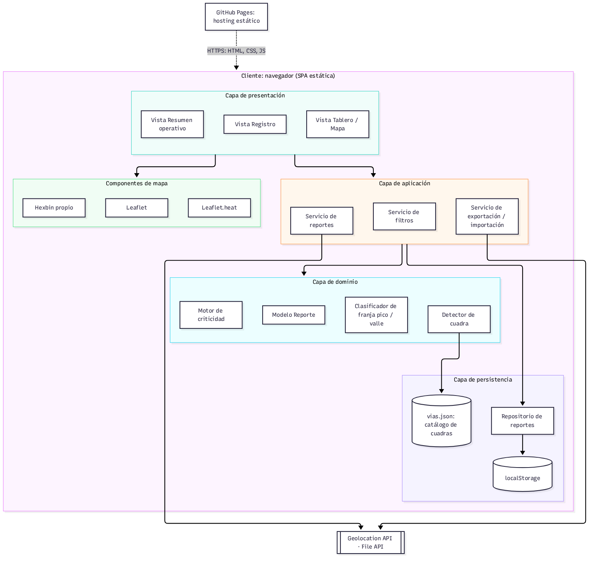

# MoviTech SM | Reto 2 — Movilidad Santa Marta
Universidad del Magdalena · Ingeniería de Sistemas · Introducción a la Ingeniería de Sistemas · 2026-II · Docente Aquiles Cohen.

## Equipo (roles propuestos, por confirmar)
- Jorge Varela: integrador del mapa e instrucciones para IA.
- Juan Peña: analista de campo y privacidad; sustentación principal.
- Daniel Narváez: lógica y clasificación.
- Nesvell Briceño: interfaz y documentación.

## Abrir el prototipo
[GitHub Pages](https://jorgevarela3009-dev.github.io/mal-parqueo/) · [Repositorio](https://github.com/jorgevarela3009-dev/mal-parqueo).
Abrir con conexión a internet. No abrir index.html directamente mediante file:// porque fetch necesita HTTP. No requiere backend.

## Uso
Activar registro, seleccionar punto o GPS, categoría, actor y hora; adjuntar foto opcional (la app pixela en el navegador, sin servidor, solo placas y rostros detectados; el original no se guarda; se puede tocar o arrastrar para cubrir lo que falte) y guardar. Consultar calor, puntos, filtros y ranking. Exportar/importar JSON para reunir dispositivos. Los datos nuevos quedan en localStorage; la base precargada se carga desde datos/reportes.json. Los IDs se deduplican.

## Datos y reglas
Nueve segmentos Calle 29H (UNI-01 a UNI-09), clasificados como vía secundaria: según OpenStreetMap (consulta Overpass del 27-11-2026) los nueve tramos coinciden con la Calle 29H3, vías 314669784 y 314669776, etiquetadas highway=residential, y solo primary/trunk se toman como arteriales; el id OSM queda en datos/vias.json. 30 entradas, 25 pico, 5 valle, 17 invasión de andén, 13 doble fila; 183 puntos de criticidad en total (243 antes de corregir la vía). Con la vía corregida y los mismos pesos y rangos quedan 8 altas y 22 medias (antes las 30 salían altas porque las cuadras estaban marcadas como arteriales). Tres jornadas informadas, fechas exactas desconocidas: fecha_hora conserva fecha técnica y hora real informada. No permite análisis diario. Registros 17/29 comparten foto, hora y cuadra; 8/30 requieren revisión por similitud. No se acredita todavía independencia de los 30. La app pixela placas y rostros al subir una foto; hay que revisar antes de guardar.

Criticidad = categoría + vía + franja. Pesos y rangos en criterios.json; pico 06:30–08:30, 11:30–14:00, 17:00–19:30. Bajo 0–4, Medio 5–6, Alto 7–9. Ranking por suma de puntos, luego cantidad e ID; recomendaciones por categoría y franja predominantes.

## Archivos
- index.html / estilos.css: interfaz.
- captura.js / via.js: captura y detección de cuadra.
- reportes.js / anonimizar.js / lib/pico/: almacenamiento e intercambio; pixelado de placas y rostros (detector pico.js + regla de color, sin CDN).
- criticidad.js / filtros.js / resumen.js: análisis.
- mapa.js / vias-mapa.js / hexagonos.js / coordenadas.js: visualización y apoyo geográfico.
- datos/: configuración, vías, criterios y reportes.
- documentos/: evidencia, arquitectura y bitácora.
- documentos/evidencias-campo/: fotos del equipo en los recorridos de campo (no son trazas GPS).
- documentos/arquitectura.png y documentos/arquitectura.mmd: diagrama de arquitectura en capas (cliente SPA sin backend).

## Arquitectura
La app es una SPA estática, sin servidor ni base de datos en línea: presentación, aplicación, dominio, mapa y persistencia local corren en el navegador, y se publica en GitHub Pages.

## Evidencia de recorridos

Estas fotos documentan al equipo en trabajo de campo en las cuadras de la Calle 29H, Santa Marta, tomando registros para el reto. No son trazas GPS: el equipo no grabó los recorridos con GPS, y esa es una limitación del entregable.

Los rostros de peatones, conductores y del integrante que aparece tomando la foto, y las placas legibles, están pixelados. El número CT305 del bus es un número de ruta de la empresa, no una placa, y se dejó visible.

- [Recorrido 1](documentos/evidencias-campo/recorrido-1.jpg)
- [Recorrido 2](documentos/evidencias-campo/recorrido-2.jpg)

## IA y pendientes
ChatGPT apoyó desarrollo y documentación. Pendiente: anexos originales de conversaciones, cronómetro RF-01, clasificación, revisión de fotos y posibles duplicados, commits individuales y video de contingencia. Los recorridos no tienen trazas GPS (ver Evidencia de recorridos). El nombre del repositorio actual no sigue literalmente la convención de nombre de equipo y reto; confirmar con el docente antes de renombrar (cambiaría el enlace).
